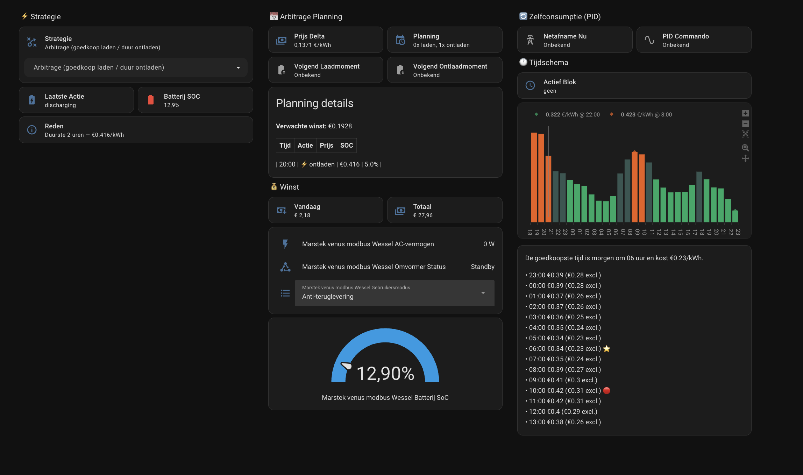

# Just Leverage Battery


[](https://hacs.xyz)
[](https://github.com/Tinus-tech/ha-just-battery-leverage/releases)

Just Leverage Battery drives a supported Marstek home battery from Home Assistant. It plans charging and discharging based on dynamic electricity prices, and also supports self-consumption, solar charging, and time schedules. You set power and SOC limits per battery. The dashboard shows the active strategy, the reason for the current decision, and the measured battery status.

It drives the battery locally over **Modbus TCP or the Marstek Local API** (your choice, depending which companion integration you have installed — see [Requirements](#requirements)) — no cloud round-trip involved.



*The included dashboard: live strategy control, the full arbitrage plan with expected profit, today's and total profit, and a price chart with the planned charge/discharge hours marked.*

---

## Why this integration

- **Looks at the whole picture, not just "cheapest N hours"** — a dynamic programming solver considers your full price forecast together with your battery's SOC limits, aiming for the most profitable plan over that horizon *according to its own model* (see [Financial figures](#financial-figures) for what that model does and doesn't account for), including partial charge/discharge slots near the SOC ceiling or floor.
- **Includes basic safeguards.** Charge/discharge only starts if the modelled price difference clears a configurable minimum, a command is only reported as "charging" after it's confirmed to have gone through, and the battery is stopped — not left running on a stale command — the moment a required sensor becomes unavailable. These are software safeguards within this integration, not a substitute for the battery's own hardware protection or your control backend's limitations — see that backend's own documentation for what it guarantees.
- **It stays put.** Anti-flip logic stops the battery from rapidly reversing direction near a price or SOC boundary, and a thermostat-style deadband keeps it from chasing every 1% SOC wobble at the top or bottom of your configured range.
- **Tracks an estimated trading result.** Daily and lifetime figures, right there as sensors — estimated from the model's own plan, not from independently metered import/export. Again, see [Financial figures](#financial-figures) before reading these as guaranteed profit.
- **Runs two batteries without a fight.** Each Marstek device gets its own config entry; the self-consumption PID controller is tuned to stay stable even when multiple batteries respond to the same grid meter.

---

## Features

| Strategy | Description |
|---|---|
| **Arbitrage** | Dynamic programming solver plans charge/discharge across the whole price forecast to maximize profit, with price-aware pre-charging and SOC-boundary hysteresis |
| **Self-consumption** | PID controller that targets zero grid import/export, with rate-limited output so it doesn't hunt |
| **Solar charging + peak shaving** | Self-consumption with solar priority and peak-import power limiting |
| **Charge to target** | Charge the battery to a configurable SOC target |
| **Discharge to minimum** | Discharge/sell until minimum SOC is reached |
| **Schedule (A/B/C)** | Time-based scheduler — run different strategies per time block |
| **UPS standby** | Battery stays charged as backup power — no trading |
| **Off** | Fully hands-off — no commands sent at all, so you can control the Marstek directly or through its own app without the integration interfering |

**Safety, always on:**
- Battery is actively stopped — not left on its last command — if the price sensor, forecast, or SOC reading becomes unavailable
- A command is only reported as "charging"/"discharging" after it's confirmed to have succeeded, regardless of control method
- Configurable min/max SOC, enforced with a deadband so the battery doesn't oscillate right at the limit
- Charge/discharge power is capped at 2500W, the Marstek Venus E v3's own hardware limit

**Multi-language:** English, Dutch (Nederlands), Spanish (Español)

---

## Requirements

Install these integrations first via HACS. **Just Leverage Battery needs one of the two control-backend integrations below, plus the price integration**:

### 1. Pick ONE control backend (required)

Just Leverage Battery never talks to the Marstek directly — it sends commands through one of these two companion integrations. Pick whichever matches your setup; both give identical trading behaviour, so this is purely a "how do I already talk to the battery" choice.

| | Modbus TCP | Local API |
|---|---|---|
| Integration | **[ViperRNMC/marstek_venus_modbus](https://github.com/ViperRNMC/marstek_venus_modbus)** | **[taurgis/has-marstek-local-api](https://github.com/taurgis/has-marstek-local-api)** |
| Connection | Ethernet, Modbus TCP (port 502) | Local network, UDP (Marstek's own "Open API") |
| Extra hardware | Needs an RS485-to-Ethernet gateway wired to the battery | None — works over the battery's existing Wi-Fi/LAN connection |
| Setup effort | More wiring, very mature/battle-tested | Simpler, no extra cabling |
| Status in this integration | Established — the original, most-tested control path | **Newer, less battle-tested** here — the integration it depends on documents the battery's local UDP API as sensitive to request bursts; see the command-frequency note below |

Known limitations of each backend (firmware quirks, request limits, reliability) live in that backend's own documentation — issues reported there aren't necessarily something this integration can work around, and this integration's own safeguards (see [Why this integration](#why-this-integration)) don't override them.

Select which one you're using under **Control method** in this integration's setup form (see [Configuration](#configuration)) — pick the wrong one and the integration will log that it can't find the battery's SOC/command entities.

**If you choose Modbus TCP**, after installing ViperRNMC's integration, configure it and set:
- **RS485 Bedrijfsmodus** (RS485 control mode) → **ON**
- **Gebruikersmodus** (User work mode) → **Handmatig** (Manual) — the Marstek may reset this to `anti_feed` on its own from time to time; that's normal and the integration's `force_mode` commands still take effect over it.

**If you choose Local API**, just install and set up taurgis's integration as documented in its README — it auto-discovers the battery on your network, no extra configuration needed on its side.

> **Note on command frequency:** the Marstek's local UDP API is known to become unstable (dropped CT002 link, unresponsive commands) under frequent or bursty requests. Just Leverage Battery only sends a `set_passive_mode` command when the target power actually changes by a meaningful amount, with an occasional keep-alive refresh so the command doesn't auto-expire in between — not on every tick. Modbus doesn't need this: it already skips re-writing a value that's already correct.

### 2. A dynamic price source (required for the Arbitrage strategy)

Arbitrage needs a sensor exposing a price forecast. The worked example below is **[fsaris/home-assistant-zonneplan-one](https://github.com/fsaris/home-assistant-zonneplan-one)**, which this integration is developed and tested against; other strategies (self-consumption, solar charging, schedule, UPS, off) don't need a price source at all.

Just Leverage Battery parses whichever of Zonneplan's two sensors you point it at — slot duration is detected automatically:

- Hourly: `sensor.zonneplan_current_electricity_tariff`, forecast items shaped like `{"datetime": "...", "electricity_price": ..., "electricity_price_excl_tax": ...}`
- Quarter-hourly: `sensor.zonneplan_current_quarter_hourly_electricity_tariff`, forecast items shaped like `{"start_date": "...", "price_tax_included": {"amount": ...}}`

> **Other providers (e.g. Nordpool):** supported in principle, but only these two exact forecast shapes are parsed — a sensor using different field names won't work without a code change. If you want to use a different provider, open an issue with that sensor's actual forecast attribute structure.

---

## Installation

### Via HACS (recommended)

1. Go to **HACS > Integrations > ... > Custom repositories**
2. Add: `https://github.com/Tinus-tech/ha-just-battery-leverage`
3. Category: **Integration**
4. Search **Just Leverage Battery** and install
5. Restart Home Assistant

### Manual

Copy the `custom_components/just_leverage_battery` folder to your HA `custom_components` directory and restart.

---

## Configuration

1. Go to **Settings > Devices & Services > + Add Integration**
2. Search **Just Leverage Battery**
3. Fill in the base settings:

| Field | Description |
|---|---|
| **Control method** | **Modbus TCP** or **Local API** — whichever companion integration (see [Requirements](#requirements)) you installed |
| **Marstek Device ID** | Copy from Settings > Devices > your Marstek device — same device, works identically for either control method |
| **Strategy** | Select your preferred trading strategy |
| **Min SOC %** | Minimum battery level — kept as reserve |
| **Max SOC %** | Maximum charge limit |
| **Charge power (W)** | Maximum charge power, up to 2500W |
| **Discharge power (W)** | Maximum discharge power, up to 2500W |

Depending on the strategy, additional settings are shown:

**Arbitrage:** Price sensor, forecast attribute, cheap/expensive hour counts, minimum price delta, pre-action window

**Self-consumption / Solar charging:** Grid power sensor (P1 meter), PID tuning parameters, peak shave limit

**Charge / Sell:** Target SOC percentage

**Schedule:** Up to 3 time periods (A/B/C) with individual sub-strategies

All settings can be changed later via **Settings > Devices & Services > Just Leverage Battery > Configure**. Have two batteries? Add the integration twice, once per Marstek device — each runs its own planning and its own profit counter.

### Checklist after first setup

Before trusting a new controller to actually run a battery, work through this:

1. **Telemetry works:** the Battery SOC sensor shows a real percentage, not `unknown`/`unavailable`. If it doesn't, the configured Marstek Device ID or control method likely doesn't match what's actually installed.
2. **The right physical battery is linked:** confirm the Device ID you entered really points at the battery you mean to control, especially with more than one battery installed.
3. **Price source is valid** (arbitrage only): the configured price sensor and forecast attribute resolve to real values with sane units — check the Arbitrage plan sensor's attributes.
4. **SOC/power limits are what you intended:** double-check min/max SOC and charge/discharge power against the battery's actual capabilities.
5. **Configured strategy matches the active strategy:** after changing the strategy via Configure, check the strategy selector entity actually shows what you just set, not the old value.
6. **Understand why it's idle/charging/discharging:** read the Decision reason sensor — "waiting" with a reason is normal, not a fault. A measured 0W alongside an idle/waiting decision reason is expected behaviour, not a problem to debug.

On a Home Assistant restart or integration reload, the configured strategy (as last saved via Configure, or last picked in the strategy selector) resumes automatically — it does not default back to Off. If you want the battery left alone across a restart, explicitly set the strategy to **Off** beforehand; manual control on another integration/app always takes priority whenever this integration's strategy is Off.

---

## Entities

After installation, these entities are created:

| Entity | Type | Description |
|---|---|---|
| Strategy selector | Select | Switch between trading strategies |
| Trading strategy | Sensor | Currently active strategy |
| Last action | Sensor | What the integration is currently doing |
| Decision reason | Sensor | Why that decision was made |
| Battery SOC | Sensor | Current state of charge (%) |
| Price delta | Sensor | Price difference cheapest vs most expensive hour in the plan |
| Next charge window | Sensor | Timestamp of the next planned charge block |
| Next discharge window | Sensor | Timestamp of the next planned discharge block |
| Arbitrage plan | Sensor | Summary + full plan (time, action, price, SOC) and expected profit as attributes |
| Today's profit | Sensor | Revenue minus cost so far today, with kWh breakdown as attributes |
| Total profit | Sensor | Estimated profit since the last reload (see [Financial figures](#financial-figures) — not yet persisted across reloads) |
| Grid power (measured) | Sensor | Current grid power for PID strategies |
| PID battery command | Sensor | Current PID output power |
| Schedule active block | Sensor | Currently active time period (A/B/C/none) |

---

## Financial figures

The expected-profit figure on the arbitrage plan sensor, and the **Today's profit** / **Total profit** sensors, are a **model estimate**, not a measurement from an energy meter. Specifically:

- Cost/revenue per tick = *configured* charge/discharge power × tick duration × the live price sensor reading at that moment — not the battery's actually metered AC power or a separate import/export meter.
- **Round-trip efficiency losses are not subtracted from the running total.** The arbitrage planner itself accounts for efficiency (default 90% round-trip) when deciding whether a cycle is worth doing at all, but the profit *counter* does not discount for it — so the real, physically realized profit is somewhat lower than what these sensors show.
- Whatever the price sensor's field returns is used as-is — whether that includes tax, network fees, or a separate (lower) feed-in tariff for exported energy depends entirely on your price sensor/forecast attribute, not on this integration.
- Battery wear/degradation is not costed in.
- **Lifetime total profit is kept in memory only** and currently resets to 0 whenever the integration reloads (a HA restart, a HACS update, or saving any setting via Configure) — it is not yet persisted across reloads. Treat it as "since the last reload," not "since installation," until this is fixed (tracked as a separate issue).

Read these sensors as an indication of whether the chosen strategy is directionally working, not as an exact, audited financial result.

---

## How Arbitrage works

Every tick, the integration builds the full price forecast and runs a **dynamic programming solver** over it:

1. Parse all upcoming price slots from the sensor's forecast attribute (hourly or quarter-hourly, detected automatically)
2. For every slot and every possible SOC level, compute the action — charge, discharge, or idle — that maximizes total profit from that point to the end of the forecast, accounting for round-trip efficiency and partial slots near the SOC limits
3. Drop any charge/discharge cycle whose price delta doesn't clear the configured minimum — a profitable-looking plan with a cycle that barely breaks even gets trimmed
4. Trace the optimal path forward from the battery's current SOC to get the plan for right now
5. If a profitable slot starts soon (configurable window) and the current price is close enough to that slot's price, start the action a little early instead of waiting for the exact boundary
6. Execute the current slot's action via whichever control method is configured — and hold it for a minimum duration once started, so the plan doesn't flip back and forth across a close call

The full plan — per slot: action, price, simulated SOC — plus the expected profit for the whole horizon is available as an attribute on the arbitrage plan sensor.

---

## Architecture

```
Just Leverage Battery (strategy & planning)
        |
        | Control method: Modbus TCP              | Control method: Local API
        v                                          v
ViperRNMC marstek_modbus                  taurgis Marstek Local API
(select.select_option, number.set_value)  (marstek.set_passive_mode service)
        |                                          |
        | Modbus TCP (port 502, ethernet)          | UDP (local network)
        v                                          v
             Marstek Venus V3 battery
```

Only one control method is active at a time — chosen via the **Control method** setting — but both companion integrations can be installed side by side without conflicting, since they use different Home Assistant domains.

---

## Manual control

Set the strategy to **Off** and the integration stops sending any commands at all, regardless of control method. You can then drive the Marstek directly through your control backend's own entities/services, or through the Marstek app, without the integration fighting you for control. Switch the strategy back and automatic control resumes on the next tick.

---

## Finding your Marstek Device ID

1. Go to **Settings > Devices & Services**, then open whichever control-backend integration you installed (**Marstek Venus Modbus** or **Marstek Local API**)
2. Click on your battery device
3. Scroll down and copy the **Device ID**

---

## License

MIT — use at your own risk. Not affiliated with Marstek, Zonneplan, ViperRNMC, or taurgis.

---

## Keywords

`home-assistant` `hacs` `marstek` `marstek-venus` `marstek-venus-v3` `marstek-modbus` `marstek-local-api` `battery` `battery-trading` `battery-arbitrage` `energy-arbitrage` `dynamic-programming` `dynamic-pricing` `zonneplan` `nordpool` `modbus-tcp` `solar-battery` `peak-shaving` `self-consumption` `energy-management` `smart-home` `home-battery` `profit-tracking` `thuisbatterij` `bateria-inteligente`
